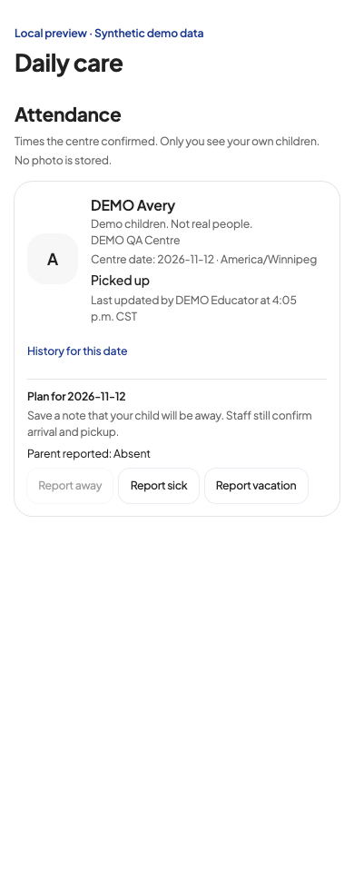
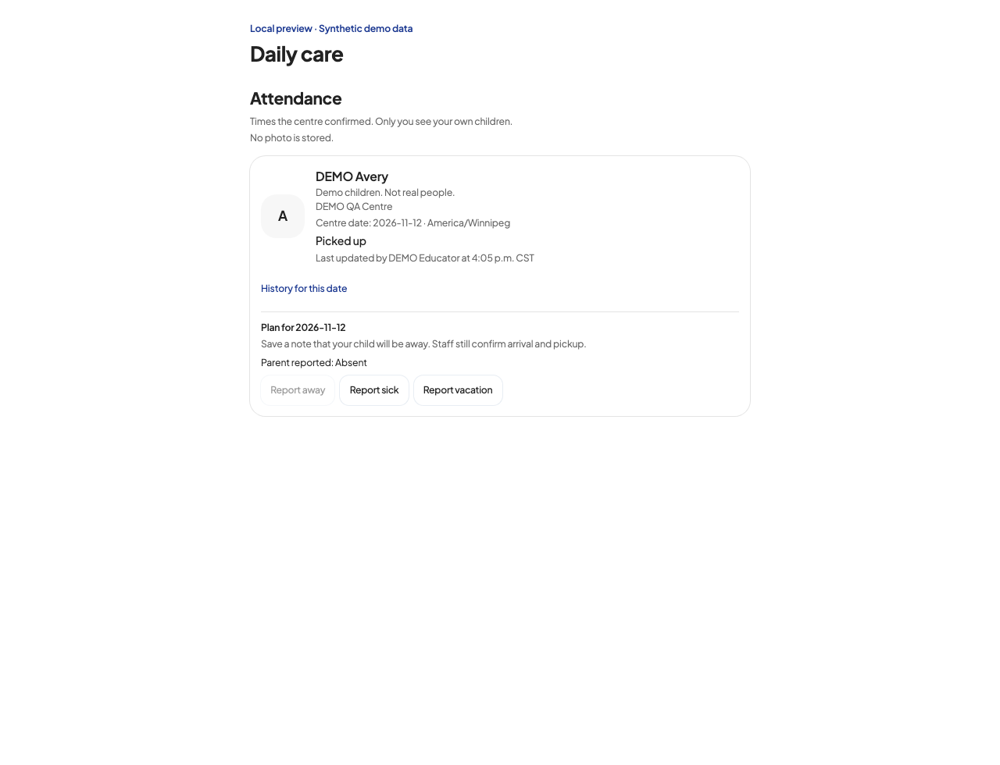

# Parent attendance summary (P04)

The parent Daily care page and classroom feed use one attendance summary per
booking, from the centre-confirmed `child_check_events`. The summary includes
the centre-local date, time zone, current status, and the latest updater's stored
name and time. With no confirmation for that date, it says “No arrival
confirmed.” Earlier arrivals, pickups, and corrections remain in the dated
history.

Parents can still report Away, Sick, or Vacation. These are labeled as parent
plans for the centre-local date. The server checks the signed-in parent's
enrolled booking, accepts only those three reports, and chooses the date from
the centre's time zone. Reports update the existing operational `attendance`
record and add a dated parent-report note to an existing in-app thread, as the
old controls did. They never write or replace staff-confirmed arrival events.
The UI claims only that the report was saved, not that an external notice was
delivered. Reports remain available when staff-confirmed attendance is off.

The `attendance` table still supports provider operations, room counts, and
the monthly ledger. Its default `scheduled` row is not a parent presence
status. A saved report is attributed to a parent only when `updated_by`
matches the booking parent and is not a current centre staff/owner account.
Records authored by someone else or a current staff/owner account are not
relabeled as parent reports. Dual-role records have ambiguous provenance in
the existing schema: reports still save, but parent attribution is
conservatively left unlabeled.
Parents keep daily notes, journals, messages, medication details, room counts,
and the monthly ledger; provider attendance controls remain in the provider
desk.

No migration or flag change is needed. The existing child check-in flag still
controls access to confirmed attendance. The existing parent reporting
capability does not turn that flag on.

## Verification

`scripts/attendance-handoff.test.mjs` uses an isolated PGlite database. It covers
arrival, pickup, manager correction, reload, latest updater, a different
parent's isolation, and the Winnipeg midnight boundary after the UTC date has
changed.

The focused suite also covers allowed report states, booking ownership,
parent/staff attribution, reports with confirmations disabled, and all ten
locale packs (24 tests total). Local screenshots of the actual summary
component use synthetic Picked up events plus a separate parent Away report
at 390px and 1280px, in English/French and classic/clean light/dark (16
combinations). They have one current attendance status, visible date/zone and
updater, no Expected conflict, no horizontal overflow, and no external
requests.

Representative local screenshots (clean look, light theme, English):

[All 16 local layout results](audits/evidence/local-attendance-results.json)
record the capture dimensions, looks, themes, languages, and browser checks.
The capture paths in that record refer to the local QA run; these two
representative images are included with the change.

These are local regression checks. Live parent/provider verification still
needs a signed-in QA session after approval and deployment. No live
functionality is claimed by these tests.
