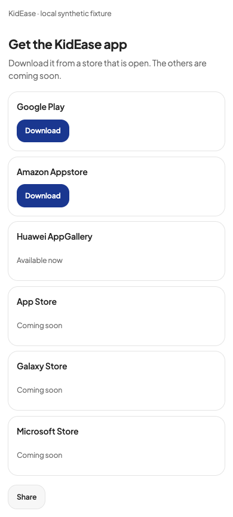
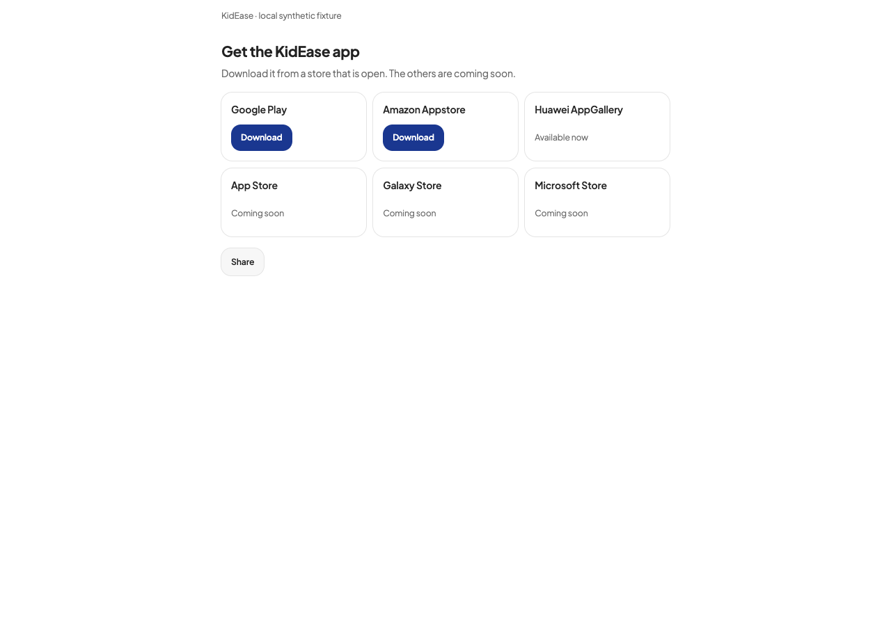
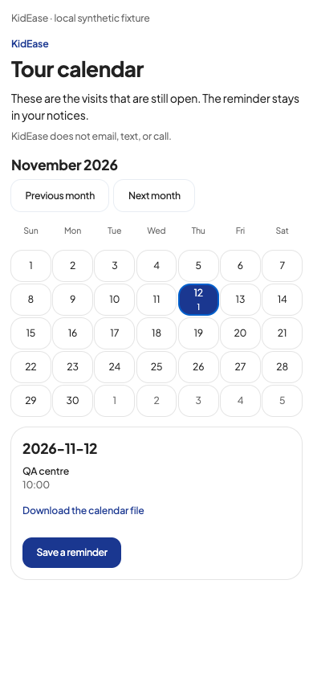
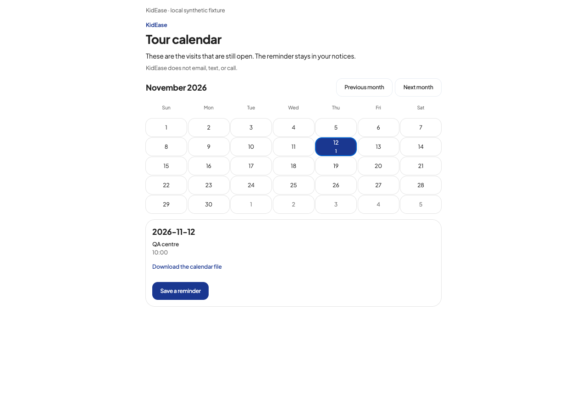

# Eight audit wording and layout changes

Baseline: `75cf0cd` (PR #840). Evidence: the current 39-page KidEase Five-Desk Audit, 12 November 2026. This PR addresses eight bounded items from that report; source implementation and local tests are separate from live acceptance.

| Finding | Change | Local acceptance |
| --- | --- | --- |
| P09, page 10 | The email invitation has one seven-day lifetime. | English/French invitation form; no invitation sent. This is a wording correction only: expiry date/status and a resend control remain unimplemented. |
| P11, page 11 | Store availability is separate from a verified download link. Huawei says Available now, based on Kyle's correction. General phone-app-coming-soon alert claims are removed. | Huawei has no invented link; its exact AppGallery URL is still unverified. Device redirects and linked-store lists still require a URL. No push delivery is claimed. |
| P12, page 11 | Parent Documents owns the title and introduction; its vault panel hides the repeated heading. Other vault callers retain their headings. | Documents heading count in enabled and disabled vault states. |
| P14, page 12 | Alert text describes the parent's task. Loading, failure with retry, and loaded-empty states are distinct. | A delayed request cannot show the empty message; failure is not empty; retry can load alerts. |
| P21, page 14 | The action and confirmation describe scheduled account deletion and the 30-day recovery period. Processor names leave the main flow; Privacy remains available. | No deletion submitted; existing retention and Apple-revocation behavior retained. |
| P22, page 14 | Password reset and forgotten sign-in email have separate guidance; support@kidease.ca is the latter's support path. | Both Email and SMS and email-edit entry points use the same English/French copy. |
| P24, page 15 | Calendar days have full date and visit-count names, selected state, and today's date state. | Adjacent-month dates, zero/one/multiple visits, English/French, keyboard selection. |
| X03, page 32 | Empty active shifts say no staff are currently clocked in; empty weekly totals retain the no-hours-this-week message. | Completed-only, active-only, and empty-week fixtures. |

## Boundaries

The custody court-order policy (D03), fee policy (G01), export choice (V06), and Stripe configuration are unchanged. No mail, text, payment, account deletion, or production data mutation is part of this change. Clean look stays opt-in and classic remains the default.

The older U1–U6/P1–P6/G1–G9 source definitions remain unlocated; they are not silently mapped onto these newer zero-padded IDs. Support A5 was already implemented in PR #830 using non-nested case routes.

## Local validation

- `npm run typecheck`: passed.
- `npm run lint`: passed, no errors and 131 warnings.
- `npm test`: 2,813 passed, zero failed or skipped. The run had no database URL and an isolated dependency cache root.
- Calendar date regression covers adjacent months, zero/one/multiple visit counts, and English/French. Store tests confirm that a live Huawei entry without a URL is excluded from download lists and device redirects.
- A synthetic component fixture ran the real changed components with read responses stubbed and mutation functions disabled. Calendar and store status passed all 16 combinations of 390px/1280px, English/French, classic/clean, and light/dark, including keyboard selection and no horizontal overflow.
- The remaining changed screens passed at both widths in English and French with clean/light: document heading count with vault on/off; seven-day invitation wording; delayed alert loading, failure and retry; scheduled deletion/support wording without submitting deletion; active, completed-only, and empty-week hour states. Twenty grouped fixture checks passed with no browser errors.

The fixture is local evidence, not a live sign-off or the official e2e smoke suite. Add the captured 390px and 1280px screenshots to the PR description. Required GitHub `check` and `e2e` results and live acceptance must be recorded by the release owner before shipping. A user-confirmed store status does not verify its direct download URL or phone push delivery.

## Screenshots

These screenshots show synthetic local component fixtures with writes disabled. [All 20 grouped fixture results](../audits/evidence/copy-20261112/results.json) are included alongside them.

